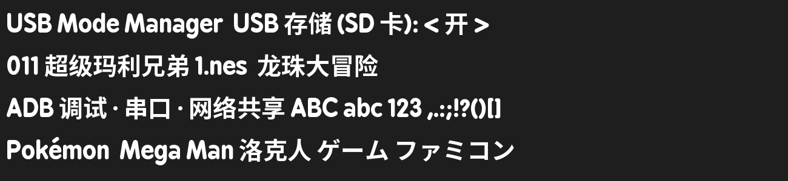
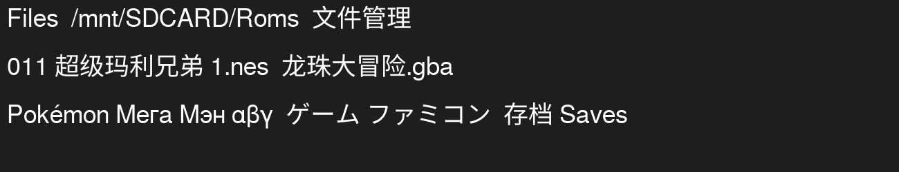

# 中文字体(MinUI / USB Mode 等所有界面)

MinUI 所有程序(minui、minarch、各个 pak)都用同一个字体文件 `.system/res/BPreplayBold-unhinted.otf`,原版只有拉丁字符,
中文显示成空白。这里的 `BPreplayBold-unhinted.otf` 是**同名替换件**(文件扩展名保持不变,内容是 TrueType,FreeType 按内容识别),
所以**不用重新编译任何程序**。

## 效果

- 拉丁字符仍是原来的 BPreplay Bold(外观不变);汉字、日文假名、全角标点来自 Noto Sans CJK SC Bold。
- 覆盖:GB2312 全部汉字和符号(约 7.4 千字)、日文假名、CJK 标点、全角形式、常用箭头/几何符号。不含韩文、GBK 里 GB2312 以外的生僻字和繁体独有字。
- 垂直度量(ascent/descent/lineGap 等)**强制设成和原字体一样**(1089/-285/31),所以按钮高度、行距、文字位置与原来一致。
- 大小 2.2 MB(原 169 KB)。预览:`preview.png`。



## 安装

```sh
# 设备在线(adb)
adb push BPreplayBold-unhinted.otf /mnt/SDCARD/.system/res/BPreplayBold-unhinted.otf
# 然后重启设备(或退出再进入程序)让字体重新加载
```

没有 adb 时,把这个文件直接复制到 TF 卡的 `.system/res/` 覆盖同名文件。

## 还原

原字体与仓库 `skeleton/SYSTEM/res/BPreplayBold-unhinted.otf` 相同,拷回去覆盖即可。

## Files.pak(文件管理器 MyCommander)

`Files.pak` 用自己的字体 `Tools/m21/Files.pak/res/FreeSans.ttf`(1.5 MB,同样没有中文)。这里的替换件是 FreeSans(拉丁/希腊/西里尔不变)+ Noto Sans CJK SC **Regular**(汉字、假名、标点,和 FreeSans 的粗细一致),同样把垂直度量固定为原字体的值,大小 3.7 MB。MyCommander 用 `TTF_RenderUTF8`,所以中文文件名可以直接显示。



```sh
adb push Files.pak/res/FreeSans.ttf "/mnt/SDCARD/Tools/m21/Files.pak/res/FreeSans.ttf"
```

没有 adb 时直接复制到 TF 卡的 `Tools/m21/Files.pak/res/` 覆盖。原字体可从发布包 `Tools/m21/Files.pak/res/FreeSans.ttf` 取回。生成脚本:`1b_subset_noto_regular.py`(需要 `NotoSansCJKsc-Regular.otf`,下载地址同上,把 `Bold` 换成 `Regular`)和 `3_merge_freesans.py`(依赖 `2_merge.py` 里的 `to_ttf()` 函数)。

## 为什么没有改仓库里的 `skeleton/SYSTEM/res/`

那个目录是**所有平台共用**的。2.2 MB 的字体会让内存小的平台(如 miyoomini)每个进程多占内存,而本 fork 没有测过。所以只作为 m21 的"替换件"放在这里,
安装到设备/TF 卡上。

## 重新生成

需要 `python3`、`fonttools`、`pillow`,以及从 <https://github.com/notofonts/noto-cjk/raw/main/Sans/OTF/SimplifiedChinese/NotoSansCJKsc-Bold.otf>
下载 `NotoSansCJKsc-Bold.otf`(约 16 MB)放在同目录。

```sh
python3 -m venv v && ./v/bin/pip install fonttools brotli pillow
./v/bin/python 1_subset_noto.py      # 裁出需要的字符,(合并这一步会因为 CID-keyed CFF 失败,属预期)
./v/bin/python 2_merge.py            # CFF 转 TrueType 轮廓后合并拉丁字体,得到 merged.ttf
# 最后把 merged.ttf 的 hhea / OS/2 垂直度量改成原字体的值,另存为 BPreplayBold-unhinted.otf(见仓库提交说明)
```

## 许可

Noto Sans CJK 采用 SIL Open Font License 1.1;拉丁部分保留 MinUI 原字体的许可。再分发时请一并保留各自的许可声明。
